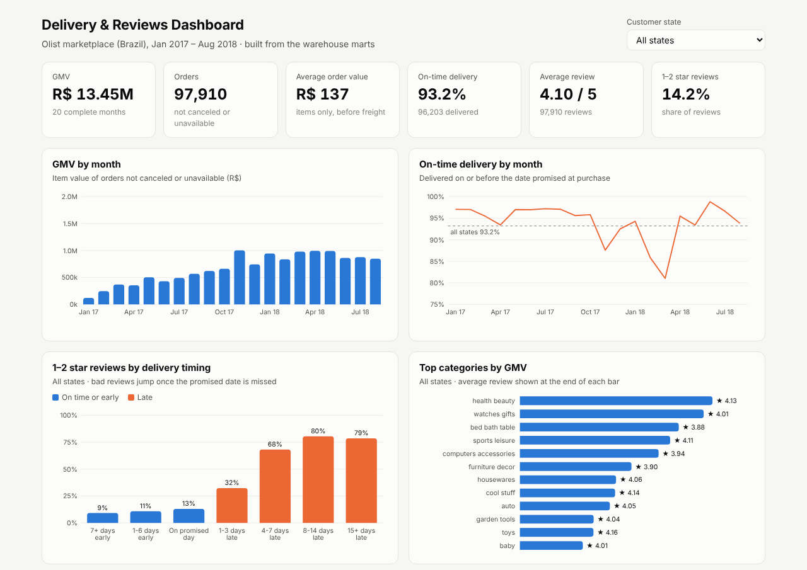
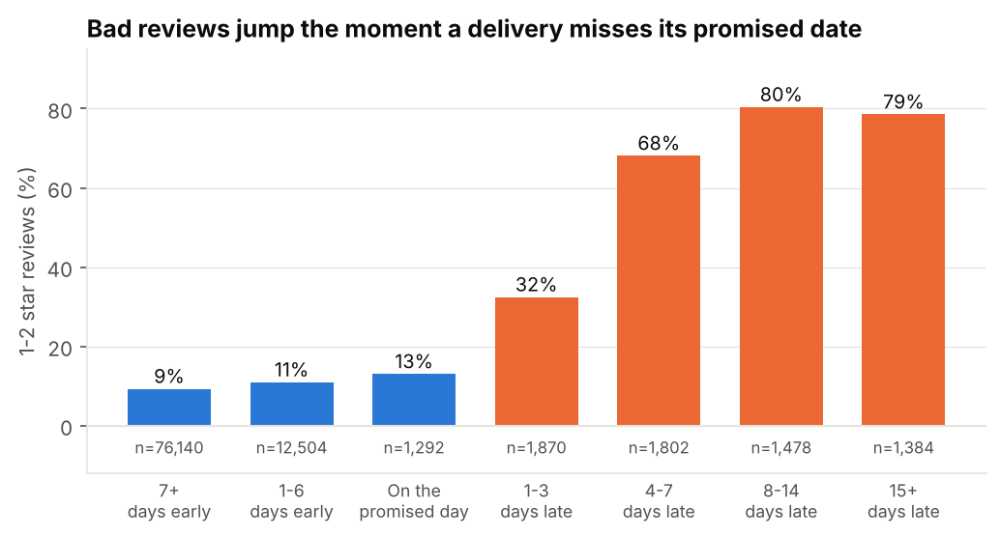

# E-commerce BI Pipeline: Late Deliveries and Bad Reviews

An end-to-end business intelligence project on **100k real marketplace orders**: an ETL pipeline that loads raw files into a **star-schema warehouse** with automated **data quality checks**, **SQL analyses**, **statistical tests**, a measured **query-performance** comparison, and an interactive **dashboard**.

**The business question:** a marketplace (Olist, Brazil, where independent sellers ship through shared logistics) wants fewer 1–2 star reviews. What drives them, and where in the delivery chain should it act?



## Key findings

- **Late deliveries drive bad reviews.** 63% of late orders get a 1–2 star review, versus 9.5% of on-time orders (chi-squared p < 0.001). After controlling for order value, freight, multi-item and multi-seller orders, state and month, a late delivery still costs **about 2 stars** (1.98, 95% CI 1.94–2.02).
- **Customers judge against the promise.** Bad reviews jump from 13% for orders delivered on the promised day to 32% at 1–3 days late and 68% at 4–7 days late.
- **Lateness explains 27% of all 1–2 star reviews**, from just 6.8% of orders.
- **Most delays happen in transit.** 72% of late orders were handed to the carrier on time by the seller; 28% were late because of the seller.
- **Late first orders cost repeat business.** Customers whose first order arrived late were 26% less likely to buy again (3.05% vs 4.13%, p = 0.001).
- **Peak months broke the promise.** On-time delivery fell to 88% in Nov 2017 (Black Friday) and 81% in Mar 2018, when delivery times rose but the promised dates didn't adjust.

**Recommendation:** set delivery promises from recent carrier speed by region and season, work with carriers on the worst routes (northeastern states and Rio de Janeiro), hold sellers to handoff SLAs, and protect first orders. Full reasoning is in the [analysis notebook](analysis/analysis.ipynb).



## Architecture

```
data/raw/*.csv.gz ──extract──▶ raw_*  ──01_staging──▶ stg_*  ──02/03──▶ star schema ──04_marts──▶ mart_*
  (8 source files)            (as-is)    clean & type      dim_date        fact_orders       │
                                                           dim_customer    fact_order_items  ├─▶ dashboard/index.html
                                         quality checks ◀─ dim_seller                        ├─▶ analysis notebook
                                         (13 blocking,     dim_product                       └─▶ exports/*.csv
                                          5 warnings)                                            (Tableau / Power BI)
```

| Layer | What happens | Where |
|---|---|---|
| **Extract** | Raw CSVs loaded unchanged into `raw_*` tables (551k rows) | `pipeline/extract.py` |
| **Staging** | Types, cleaning rules, deduplication, all documented in one SQL file | `pipeline/sql/01_staging.sql` |
| **Star schema** | 4 dimensions and 2 fact tables (item grain and order grain), with enforced foreign keys and `CHECK` constraints | `pipeline/sql/02_dimensions.sql`, `03_facts.sql` |
| **Marts** | 5 pre-aggregated tables for dashboards and recurring reports | `pipeline/sql/04_marts.sql` |
| **Quality** | 18 checks after every load: reconciliation to source, uniqueness, referential integrity, validity, cross-mart consistency | `pipeline/quality.py` |
| **Logging** | Row counts and duration per step, plus every check result, stored by run ID | `etl_run_log`, `dq_results` tables |

See [docs/data_model.md](docs/data_model.md) for the ER diagram and design decisions, and [docs/metrics.md](docs/metrics.md) for metric definitions.

## Data quality

Real data is messy. These problems were found in profiling and are handled by a documented rule, then monitored on every run:

| Source issue | Rows | Rule |
|---|---|---|
| A new `customer_id` for every order | 99,441 IDs for 96,096 people | Customer dimension keyed on the person (`customer_unique_id`) |
| Duplicate reviews | 559 | Keep the most recently answered review per order |
| Products with no category | 610 | Labeled `unknown` |
| Categories missing a translation | 2 | Translated in staging |
| "Delivered" orders with no delivery date | 8 | Excluded from delivery metrics |
| Payments not matching item totals | 250 | GMV uses item prices, which reconcile to the cent |

**Blocking checks** stop the pipeline if, for example, a row is lost between raw and warehouse, revenue doesn't reconcile to the source, a fact points at a missing dimension row, or two marts disagree on the same KPI.

## Performance

Same questions answered three ways (median of 7 runs, from the notebook; timings vary by machine):

| Question | Raw tables | Star schema | Mart |
|---|---|---|---|
| Monthly GMV and on-time rate | 326 ms | 146 ms (2.2× faster) | 0.02 ms |
| Top 20 sellers by GMV with late rate | 560 ms | 418 ms (1.3× faster) | 0.18 ms |

An index on `fact_order_items.seller_key` turns one seller's order lookup from a full table scan (6.4 ms) into an index search (1.4 ms). The dashboard reads only marts, a few hundred rows in total. Across repeated runs the star schema was consistently 1.3–3× faster than the raw tables and the marts thousands of times faster.

## SQL analyses

Each is a standalone file in [`analysis/queries/`](analysis/queries):

| Query | Techniques |
|---|---|
| `q01_monthly_growth.sql` | `LAG` for month-over-month growth, moving average, year-to-date running total |
| `q02_delivery_by_state.sql` | `GROUP BY` / `HAVING`, `RANK()` |
| `q03_late_root_cause.sql` | Attributing late orders to seller vs carrier, share of total with a window function |
| `q04_seller_concentration.sql` | `NTILE` deciles, cumulative share (top 10% of sellers = 67.5% of GMV) |
| `q05_repeat_purchase_cohorts.sql` | Cohort analysis of second-purchase rates at 90 and 180 days |
| `q06_promise_accuracy.sql` | Promised vs actual delivery time by month |

## Repository structure

```
ecommerce-bi-pipeline/
├── data/raw/                  # 8 source files (gzipped CSV, 28 MB)
├── pipeline/
│   ├── extract.py             # raw CSV -> raw_* tables
│   ├── sql/                   # 00_teardown, 01_staging, 02_dimensions, 03_facts, 04_marts
│   ├── quality.py             # data quality checks
│   ├── run.py                 # pipeline runner (python -m pipeline.run)
│   └── export.py              # CSV extracts for Tableau / Power BI
├── analysis/
│   ├── analysis.ipynb         # findings, statistics, recommendations (executed)
│   ├── queries/               # the SQL analyses
│   ├── bi_stats.py            # chi-squared, Welch t-test, OLS with robust SEs
│   └── benchmark.py           # query-performance comparison
├── dashboard/
│   ├── index.html             # interactive dashboard (open in a browser)
│   ├── template.html
│   └── build_dashboard.py
├── exports/                   # mart CSVs, ready for Tableau / Power BI
├── docs/                      # data model and metric definitions
├── reports/figures/
└── tests/                     # 13 tests: cleaning rules, measures, idempotency, quality gates
```

## How to run

The pipeline uses only Python's standard library (SQLite is built in). The notebook and tests need the packages in `requirements.txt`.

```bash
git clone https://github.com/kennethpangestu/ecommerce-bi-pipeline.git
cd ecommerce-bi-pipeline
python -m venv .venv
.venv\Scripts\activate              # Windows   (macOS/Linux: source .venv/bin/activate)
pip install -r requirements.txt

python -m pipeline.run              # build warehouse.db (~15 s)
python -m pipeline.export --detail  # optional: CSV extracts
python dashboard/build_dashboard.py # rebuild the dashboard
pytest                              # run the tests
jupyter lab analysis/analysis.ipynb
```

Open `dashboard/index.html` in any browser; it needs no server. To publish it, enable GitHub Pages for this repo.

## Limitations

- **Observational data.** The regression controls for measured factors but can't rule out unmeasured ones; an A/B test of promise dates would confirm the causal effect.
- **Single-node SQLite.** Right for 100k orders. At larger scale the same design maps directly onto a cloud warehouse (e.g. Redshift or BigQuery), with partitioned facts and incremental loads instead of full rebuilds.
- **Reviews stand in for satisfaction**, and almost every order in this dataset has one, which may not hold elsewhere.

## Data and license

[Brazilian E-Commerce Public Dataset by Olist](https://www.kaggle.com/datasets/olistbr/brazilian-ecommerce), real anonymized orders from 2016–2018, licensed **CC BY-NC-SA 4.0**. The data in `data/raw/` and everything derived from it (warehouse, extracts, figures) is shared under the same license; see [`data/README.md`](data/README.md).
