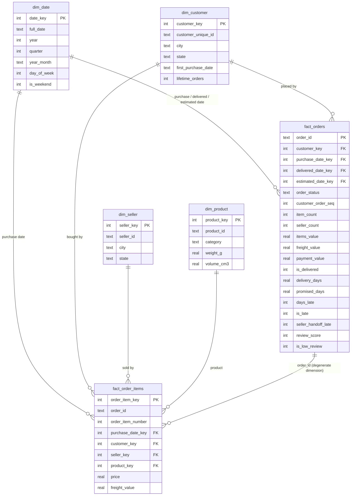

# Data model

The warehouse has four layers, each built from the one before it by the SQL files in `pipeline/sql/`:

| Layer | Tables | Purpose |
|---|---|---|
| **Raw** | `raw_*` (8 tables) | Source CSVs loaded as-is (all text). The warehouse can always be rebuilt from here. |
| **Staging** | `stg_*` (7 tables) | Typed, cleaned, one row per entity. All cleaning rules live in `01_staging.sql`. |
| **Star schema** | `dim_*` (4), `fact_*` (2) | The model analysts query. Integer surrogate keys, enforced foreign keys. |
| **Marts** | `mart_*` (5) | Small pre-aggregated tables for dashboards and recurring reports. |

## Star schema

## Grain of each fact table

- **`fact_order_items`**: one row per product line in an order (112,650 rows). Use it for anything about products, categories or sellers.
- **`fact_orders`**: one row per order (99,441 rows). This is an *accumulating snapshot*: it follows each order from purchase through carrier handoff and delivery to review, so delivery and review measures sit on one row. Use it for anything about orders, customers, delivery or reviews.

Keeping two grains avoids a classic BI bug: summing an order-level value (like freight or review score) from an item-level table counts multi-item orders more than once.

## Design decisions

| Decision | Why |
|---|---|
| `dim_customer` is keyed on `customer_unique_id`, not `customer_id` | The source issues a new `customer_id` for every order. Keying on it would count 99,441 "customers" instead of 96,096 people and make repeat purchases invisible. |
| Integer `date_key` (e.g. `20180315`) joined to `dim_date` | Cheap integer joins, plus ready-made calendar attributes (month, quarter, weekday) without date math in every query. |
| Delivery measures (`is_late`, `days_late`, `seller_handoff_late`) are computed once at load time | Every report uses the same definition of "late", and queries don't recompute date differences row by row. |
| `seller_handoff_late` compares the carrier pickup time with the seller's shipping deadline | Splits lateness into seller-caused and carrier-caused, so each team gets an actionable number. |
| Seller delivery and review metrics use single-seller orders only | A late or badly reviewed order with two sellers can't be blamed on either one. That's 98.7% of orders. |
| Foreign keys and `CHECK` constraints are declared and enforced | A broken row fails the load instead of silently producing wrong dashboards. |
| Indexes on fact foreign keys and date keys | Turns filtered lookups from full scans into index searches (see `analysis/benchmark.py`). |
| Full rebuild with an explicit teardown step | At this size (about 13 seconds) a full rebuild is simpler and safer than incremental loads; the teardown drops tables in dependency order so foreign keys never block a rebuild. |
